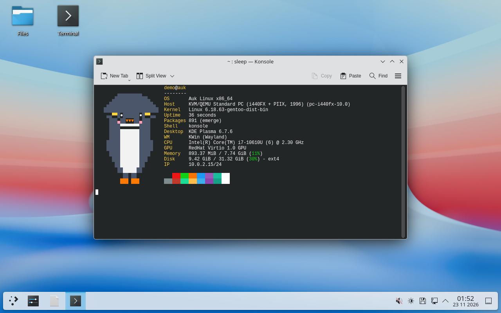
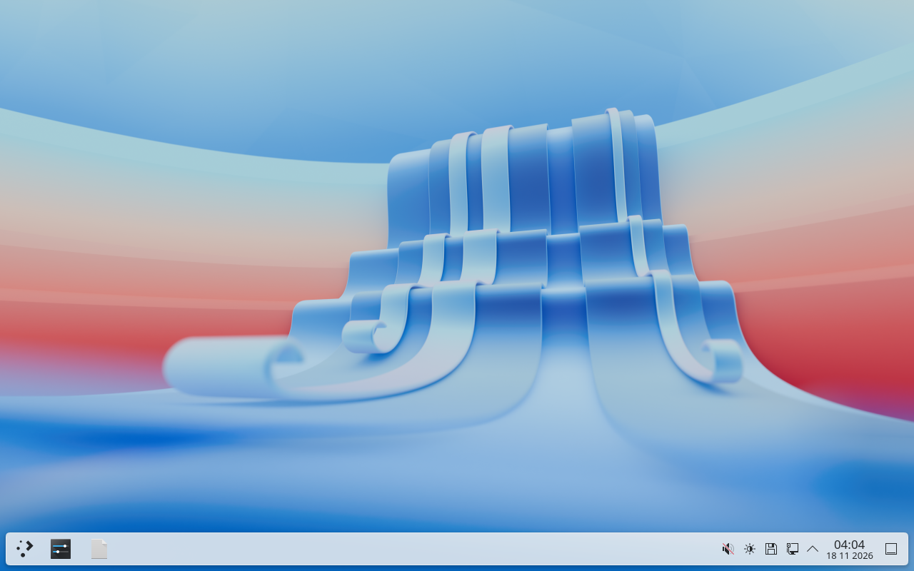
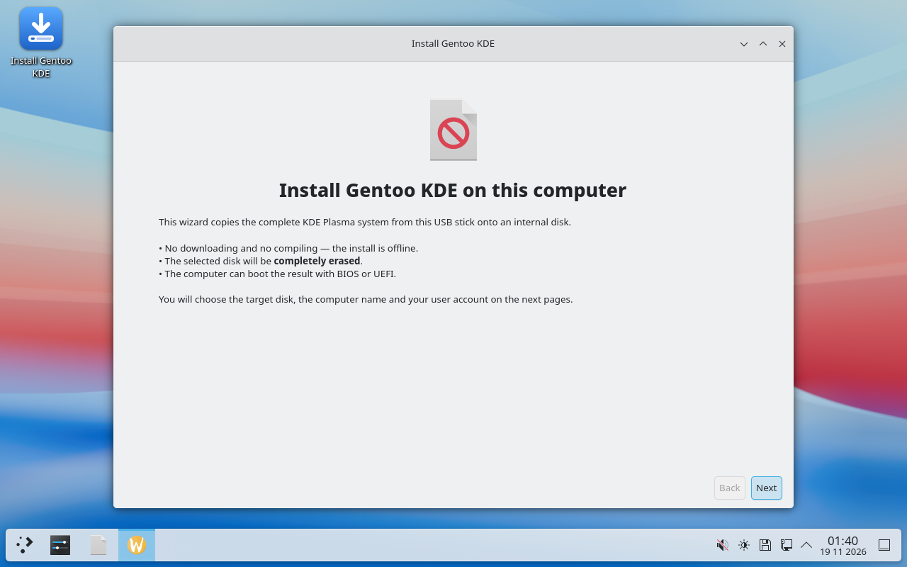
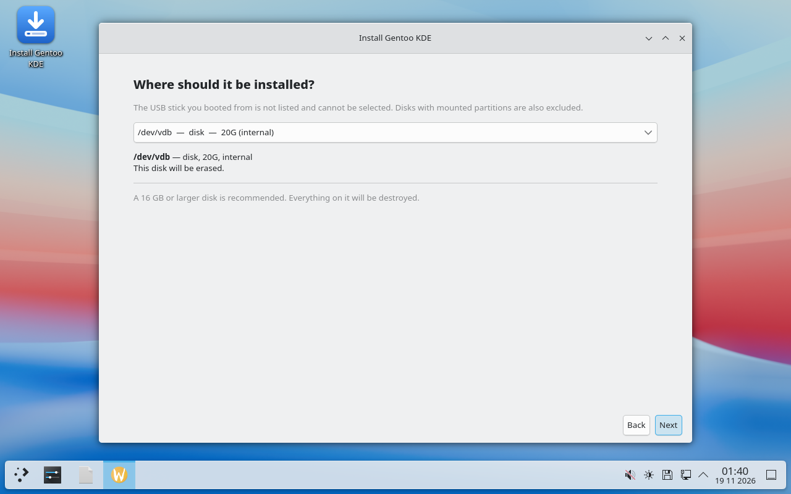

# Auk

**A beginner-friendly, zero-compilation Linux desktop built from Gentoo binary
packages.** Auk boots from a USB stick into KDE Plasma, ships a graphical
one-click installer, and installs every package from Gentoo's official binary
host — nothing is compiled on the user's machine.

**Download:** <https://jacoblockard2007-hub.github.io/auk-linux/> — the
landing page with the download commands, checksums and screenshots.

```sh
git clone https://github.com/jacoblockard2007-hub/auk-linux.git
cd auk-linux
```

> **Why is the clone only ~13 MB?** Git holds the source, scripts and docs. The
> 14 GiB bootable image is published as split release assets; fetch it with
> `bin/download-image.sh`.

> **Status:** working prototype. The build pipeline, USB image, installer and
> desktop have all been tested end to end on BIOS and UEFI; installer polish and
> hardware coverage are still in progress.



## Get the image

The release image is a 14 GiB **persistent** disk that boots on both BIOS and
UEFI machines and fits a 16 GB USB stick. It is compressed and split into parts
smaller than GitHub's 2 GiB per-asset limit, so it is not stored in git:

```sh
bin/download-image.sh
```

The script downloads the parts, verifies every SHA-256, joins them and
decompresses `dist/auk-linux-usb.img` (~14 GiB). To build it yourself instead,
see the pipeline below.

## Boot it now

```sh
bin/boot-kvm.sh                                   # boot it in a local KVM window
bin/boot-kvm.sh --uefi                            # same image, UEFI firmware
(cd dist && sha256sum -c SHA256SUMS)              # verify the image files
sudo bin/write-usb.sh /dev/sdX dist/auk-linux-usb.img   # write a USB stick
```

See [docs/KVM.md](docs/KVM.md) and [docs/USB.md](docs/USB.md). The USB stick is
a real installed system: changes persist, and it boots on its own. It also
carries a **GTK 4 “Install Auk Linux” wizard** that copies that system onto an
internal disk, so a beginner never sees a command line. See
[docs/INSTALLER.md](docs/INSTALLER.md).

## Why this is possible now

Gentoo's official binary host is a **multi-variant** repository: it carries
several builds of the same package, differing in USE flags and ABI
(`sys-apps/dbus` alone has 30 builds). Portage picks the build matching the
system's profile, so a desktop install can be 100% binary *if the profile
matches the host's build profiles*.

The important consequence: `--binpkg-respect-use=y` is mandatory. Forcing
`--binpkg-respect-use=n` makes Portage grab the newest build regardless of
variant, which drags in the wrong init system and unsatisfiable 32-bit deps
(this bit me during development).

## Architecture

| Layer | Choice | Notes |
|---|---|---|
| Base | `stage3-amd64-desktop-systemd` | desktop profile, systemd, no compiler use |
| Init | systemd | the official binhost's desktop variants are built for it |
| Desktop | `kde-plasma/plasma-meta` | Plasma 6.7.6 at time of writing |
| Packages | Gentoo official binhost | `.../binpackages/23.0/x86-64/` |
| Installer | GTK 4 wizard + shell clone backend | offline; no Calamares, nothing compiled |
| Terminal | `kde-apps/konsole` (binary) | desktop icon, menu entry, and a text console on tty3 |
| Files | `x11-misc/pcmanfm-qt` (binary) | desktop icon and menu entry; no KDE runtime needed |
| System info | fastfetch 2.71.0 (vendored) | `auk` shows the Snares penguin logo and system summary |
| Wi-Fi | NetworkManager + Debian firmware | `nmtui`; firmware fetched by `installer/install-wifi-firmware.py` |
| Kernel | `sys-kernel/gentoo-kernel-bin` | prebuilt kernel + dracut initramfs |
| Bootloader | GRUB (BIOS + UEFI) | GPT: `bios_grub` for i386-pc, ESP fallback for x86_64-efi |

## Layout

```
bin/qdrive.py           expect-style serial console driver for QEMU
bin/phase1_install.py   boot live env, run installer  (--dry-run, --reuse)
bin/phase2_boot.py      boot installed system, verify, screenshot
bin/build_usb.py        build the hybrid BIOS+UEFI USB image
bin/verify_image.py     boot the USB image (BIOS or --uefi), verify, screenshot
bin/boot-kvm.sh         one-command local KVM launcher
bin/write-usb.sh        guarded USB writer (raw image, or .img.xz)
bin/test_installer.py   end-to-end install to a second disk + BIOS/UEFI boot test
bin/gui_smoke.py        launch the GTK wizard live, capture pages, pkexec dry-run
bin/binhost-inspect.py  inspect a Packages index: variant coverage per package
installer/live-stage1.sh    partitioning + stage3 extract, runs in live env
installer/chroot-stage2.sh  package install + system config, runs in chroot
installer/build-usb-image.sh  GPT layout + rootfs copy + installer injection
installer/finalize-usb.sh     initramfs + GRUB (BIOS/UEFI), runs in chroot
installer/install-to-disk.sh  installer backend: partitions, clones, finalizes
installer/finalize-install.sh chroot finalizer for the installed disk
installer/gui-installer.py    GTK 4 install wizard
installer/gentoo-installer.svg  installer icon shipped in the image
installer/49-gentoo-installer.rules  polkit rule for the backend path
installer/install-fastfetch.sh  vendor fastfetch + the Auk logo into an image root
installer/install-branding.sh  apply os-release, hostname and GRUB identity
installer/install-grub-theme.sh  install the Auk GRUB logo and menu layout
installer/grub-theme/           Auk GRUB theme artwork
installer/install-wifi-firmware.py  fetch Debian Wi-Fi firmware into an image root
installer/fastfetch/            vendored fastfetch 2.71.0, auk.txt, config, MIT license
work/                   kernel, initramfs, disk image, screenshots
dist/                   distributable .img and checksum
logs/                   full serial console logs of every run
docs/USB.md             writing and booting the USB image
docs/KVM.md             KVM options and headless verification
docs/INSTALLER.md       installer flow, backend behavior, testing, limits
docs/PERFORMANCE.md     measured idle CPU/RAM on the 2 GB Chromebook
docs/fastfetch.png      the Auk Snares penguin logo in Konsole
docs/grub.png           the Auk GRUB boot menu
```

## Reproducing

```sh
# downloads (stage3, live ISO) and checksum verification happen first;
# see logs/ for the exact URLs used.

python3 bin/phase1_install.py stage3-desktop.tar.xz --dry-run   # measure
python3 bin/phase1_install.py stage3-desktop.tar.xz             # install
python3 bin/phase2_boot.py                                      # boot + screenshot
python3 bin/build_usb.py --force                                # make dist image
python3 bin/verify_image.py && python3 bin/verify_image.py --uefi
python3 bin/test_installer.py --force                           # install to 2nd disk + boot it
python3 bin/gui_smoke.py                                        # wizard pages + pkexec dry-run
```

## Root cause of the first failed runs

The first install attempts reached partitioning and stage3 extraction, then died
in dependency resolution. The cause was narrower than "the binhost is
incomplete": the multilib desktop profile and the binhost disagree about which
packages get 32-bit ABIs.

Measured against the index (`bin/binhost-inspect.py --index Packages`):

| Fact | Value |
|---|---|
| Base profile | `default/linux/amd64/23.0/desktop/systemd` (multilib) |
| Build stanzas in the index | 18,305 |
| Packages covered | 7,322 |
| Multi-variant packages | 3,171 |
| Packages shipping a 32-bit build | 222 |
| `sys-libs/glibc` variants | 21, including `multilib` |
| `x11-libs/libX11` variants | **1, 64-bit only** |

The profile force-enables `abi_x86_32` on a base package set — which is the 222
packages with 32-bit builds — but that set does not include `libX11`. The
resolver therefore selects the 32-bit `x11-libs/libXext` build and then cannot
satisfy its `libX11[abi_x86_32]` dependency:

```
emerge: there are no ebuilds built with USE flags to satisfy
  ">=x11-libs/libX11-1.6.2[abi_x86_32(-),abi_x86_64(-)]"
```

Fixes now in `installer/chroot-stage2.sh`:

1. `ABI_X86="64"` plus `USE="-abi_x86_32"` in `make.conf`. A beginner desktop
   does not need 32-bit compatibility, and disabling it puts every package on
   the fully-built 64-bit variant set.
2. `--autounmask-backtrack=y`. Portage names this flag itself when it aborts:

   ```
   * the --autounmask-backtrack=y option can be used to force further backtracking
   ```

An earlier `kwin[lock]` failure was a separate mistake: that run used the plain
`stage3-amd64-systemd` instead of `stage3-amd64-desktop-systemd`, so too few
profile USE flags were set to match any kwin build. The desktop stage3 is
required.

## Results

Dependency resolution for `kde-plasma/plasma-meta` on this base:

```
PLAN total=328 binary=328 ebuild=0
```

The prototype then completed end to end on 2026-11-18 in QEMU (8 GiB RAM,
6 vCPU, virtio disk, BIOS/GRUB):



| Metric | Value |
|---|---|
| KDE packages installed | 328, **all binary** |
| Packages compiled | **0** |
| KDE install time | 9m49s (includes repo sync + binhost index) |
| Kernel + bootloader stage | 2m33s (reused the KDE install) |
| Boot to Plasma | ~2 minutes |
| Desktop | Plasma 6.7.6, Wayland, autologin as `demo` |
| Kernel | 6.18.63-gentoo-dist-bin |
| First boot | `running`, no failed units, `demo` on `seat0` |

### Idle usage on the target Chromebook

Measured with `htop` on the 2-core / 2 GB Chromebook, after Plasma settled and
with no applications open:

| Desktop | CPU idle | RAM idle |
|---|---|---|
| KDE Plasma 6.7.6 | **5–10%** | **~700 MB** |
| i3 | pending | pending |

Method and comparison plan: [docs/PERFORMANCE.md](docs/PERFORMANCE.md).

### Bootable artifact: USB and KVM

The working disk was then turned into a distributable image,
`dist/auk-linux-usb.img`: 14 GiB raw (9.6 GiB allocated), GPT with a 1 MiB
BIOS boot partition, a 512 MiB ESP, and a 13.5 GiB ext4 root. `dist/SHA256SUMS`
covers the raw image. GRUB is installed
twice — `i386-pc` for BIOS and `x86_64-efi` at the removable fallback path
`EFI/BOOT/BOOTX64.EFI` for UEFI — and the initramfs is rebuilt generically.

| Check | Result |
|---|---|
| BIOS (SeaBIOS), image as first disk | booted, `running`, 0 failed units, SDDM active, Plasma session |
| UEFI (OVMF 4M), fallback path | booted via `BdsDxe`, same state |
| BIOS, USB as **second** disk (`/dev/vdb3`) | booted, SDDM active |
| Root mount | by UUID; fstab has UUIDs for root and ESP |
| Size | 14.0 GiB raw, 9.6 GiB allocated, fits a 16 GB stick |

Screenshots: [BIOS](docs/usb-bios.png), [UEFI](docs/usb-uefi.png),
[boot menu](docs/grub.png).

### Installer: USB to internal disk

The image carries a GTK 4 wizard plus a root backend that clones the live
system to a target disk. It was tested end to end by attaching a blank 20 GiB
disk to the same VM, installing from the USB image, then booting the target
**alone** under BIOS and UEFI.





| Check | Result |
|---|---|
| Installer assets on image | backend, chroot finalizer, GUI, desktop entry, polkit rule |
| Backend run | repartition `/dev/vdb`, copy 8.7 GiB, `FINALIZE_INSTALL_OK` |
| Install time (KVM, virtio) | partition + copy + GRUB: ~90 s |
| Target boot, BIOS | `running`, 0 failed units, SDDM active |
| Target boot, UEFI (OVMF) | same state |
| Installed account | `testuser` login, Plasma autologin session on `seat0` |
| Target layout | `/dev/vda3` ext4 root, `/dev/vda2` vfat ESP |
| Installer removed | live installer and polkit rule deleted from target |

One teardown bug surfaced: after a successful finalize, `umount -R /mnt/target`
failed on a busy `/mnt/target/dev/pts` and the backend reported failure. Cleanup
now syncs first and falls back to lazy detach of the nested pseudo-filesystems,
so a successful install exits 0.

Two portability bugs surfaced and were fixed while building it:

- **Host-only initramfs.** The install-time dracut image contained only virtio
  drivers, so it would fail to find the root filesystem on real SATA/NVMe/USB
  hardware. The USB build now runs `dracut --no-hostonly`.
- **Read-only mounts cannot replay a dirty journal.** After a VM shutdown the
  source ext4 needed journal recovery, and `mount -o ro` refused. The build
  mounts it read-write just long enough to replay, remounts read-only, then
  copies.

`bin/boot-kvm.sh` boots the image in one command; `bin/verify_image.py`
reproduces the checks above. Details in [docs/USB.md](docs/USB.md) and
[docs/KVM.md](docs/KVM.md).

One firmware caveat: if the internal disk is blank, some BIOS implementations
try it and stop instead of falling through to the USB. That is firmware
behaviour, not GRUB — the image boots correctly when the firmware is told to
boot the stick (verified with the stick as `/dev/vdb`). Always use the boot
menu to select the USB device.

One package arrives as `[ebuild]` rather than `[binary]`:
`sys-kernel/gentoo-kernel-bin`. That is expected — it installs an
already-built kernel image, so nothing is compiled, but the binhost carries no
kernels at all. It is also why the installer generates the initramfs itself.

### Findings that matter for the product

1. **Profile choice is the whole game.** The binhost builds variants for
   specific profiles. Using `desktop/systemd` makes `plasma-meta` unsatisfiable
   (`kwin[lock]` has no matching build). Using `desktop/plasma/systemd`, the
   profile the host was built from, everything matches. A distro must pin this
   profile and treat any change as a release engineering decision.
2. **`--binpkg-respect-use=y` is mandatory** (see above).
3. **Two packages are simply absent from the binhost**: `sys-apps/tuned` and
   `sys-apps/ethtool`. `tuned` is one of three alternatives accepted by
   `powerdevil`, so masking it and using `power-profiles-daemon` (9 builds
   available) removes the entire source-build chain.
4. **Python target drift** can silently force compiles: `dev-python/psutil`
   (needed by `drkonqi`) is built for 3.13+3.14 in the binhost, while the
   profile requests 3.14 only. One line of `package.use` fixes it.
5. **Desktop stage3 already contains KDE Frameworks 6** (145 packages), which
   is why the install is 328 packages rather than ~800.
6. **The binhost lags the ebuild tree by days.** `sys-kernel/installkernel`
   70-r1 exists only as an ebuild; the binhost carries 68-r1. Installing
   `gentoo-kernel-bin` normally pulls `installkernel[dracut]` and drags you
   into a source build. Two workarounds, both applied: pin to 68-r1, and
   install the kernel with `USE=-initramfs`, generating the initramfs with
   `dracut` afterwards. A real distro should instead **sync its ebuild tree to
   the binhost's `REPO_REVISIONS` commit**, which removes this whole class of
   failure.
7. **The binhost carries no kernels at all** (`gentoo-kernel-bin` is absent).
   Its ebuild installs a prebuilt kernel tarball, so no compiler runs, but it
   is technically an ebuild. Any serious attempt needs its own kernel binpkg.

Measured install: 328 binary packages merged in **9m49s**, `Compiling source`
lines in the Portage log: **0**. Konsole, PCManFM-Qt and the Debian Wi-Fi
firmware are installed by the same stage after that baseline. `--usepkgonly` is used so a missing binary
aborts instead of falling back to compiling.

## What a real product still needs

1. **A product-grade installer.** The GTK 4 wizard now does whole-disk
   offline installs, but a product needs disk selection against an existing OS
   (shrink/dual-boot), encryption, a separate admin account, and recovery.
2. **Our own binhost.** Relying on Gentoo's means inheriting its exact profile,
   USE flags and update cadence. CI must rebuild `.gpkg` files for our profile
   on every sync.
3. **Flatpak + Discover** as the beginner-facing app store, with Portage hidden.
4. **Rollback.** btrfs + snapper, so a bad update is one click to undo.
5. **Upstream attribution and trademark.** The project is named Auk and
   credits Gentoo as its base; the desktop, installer, GRUB and fastfetch
   identity all read Auk Linux, and the trademark position should be reviewed.
6. **Update UX.** A tray notifier that runs `emerge --getbinpkg -uDN @world`
   and never drops a beginner into a Portage blocker.

## License

Auk is released under the [MIT License](LICENSE). Third-party components keep
their own licenses; see [THIRD_PARTY.md](THIRD_PARTY.md). Auk is an independent
project based on Gentoo Linux and is not affiliated with or endorsed by the
Gentoo Foundation.
