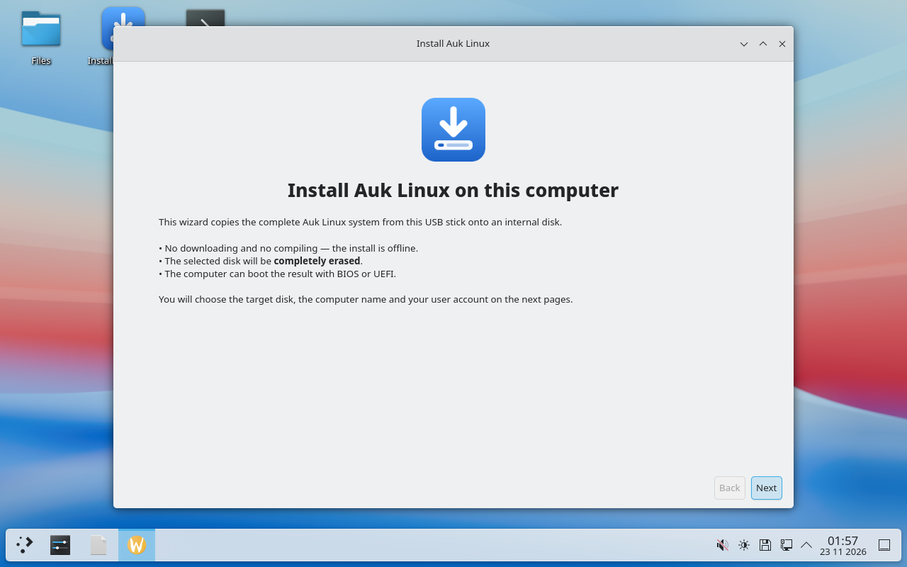
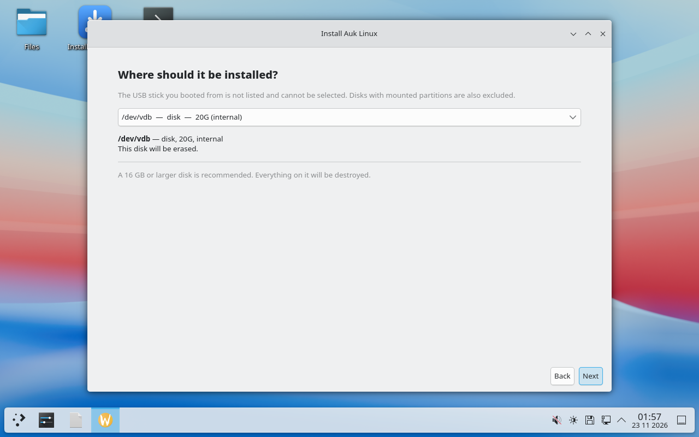
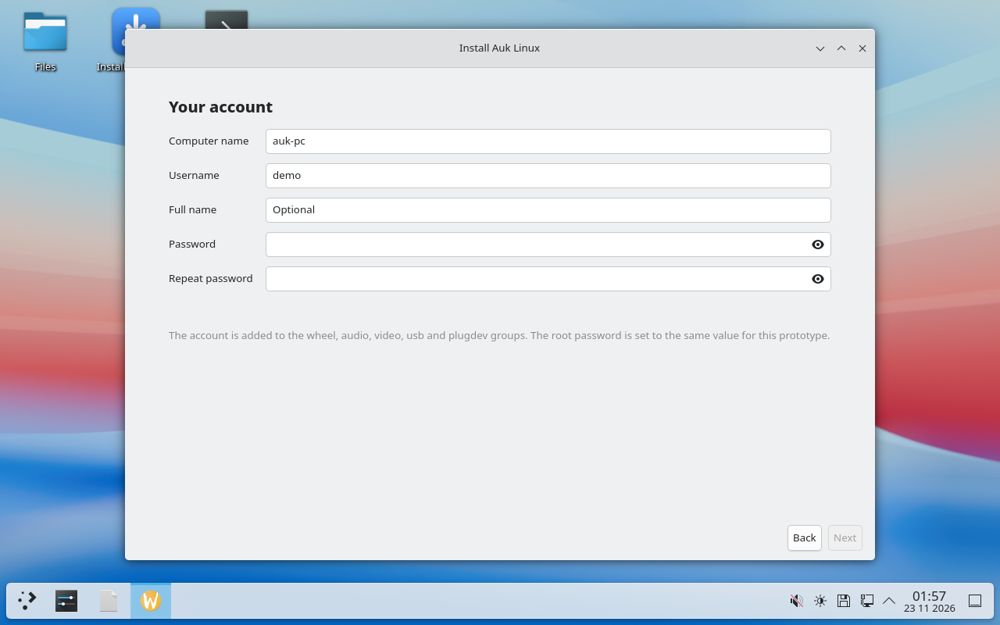
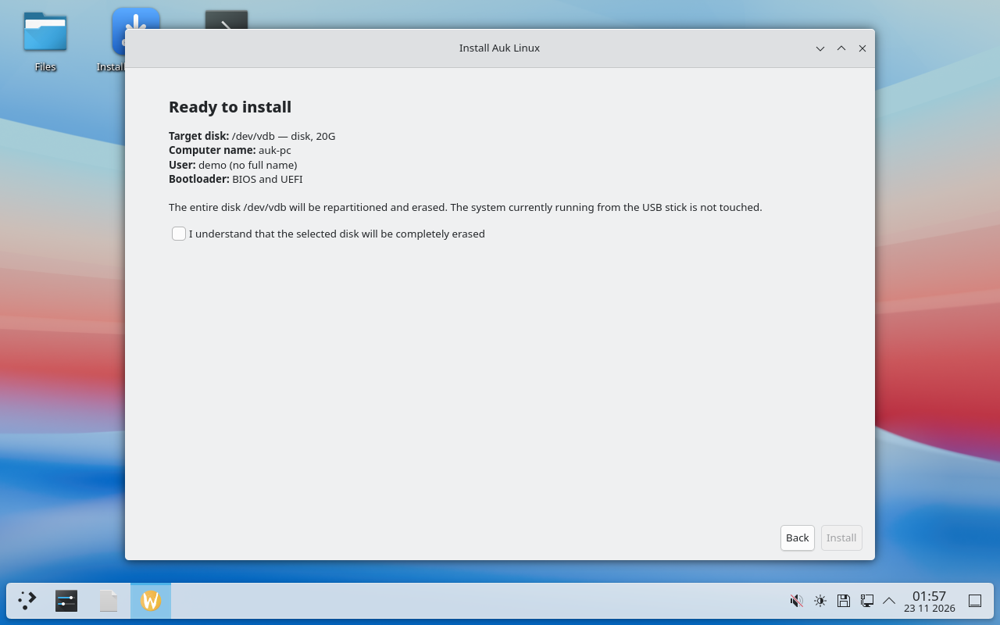
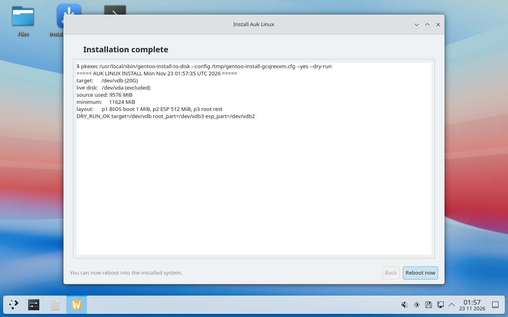

# The graphical installer

The USB image includes a **GTK 4 “Install Auk Linux” wizard**. On the live
desktop, double-click the **Install Auk Linux** icon (it is also in the
application menu under System).

The installer is offline: it copies the running USB system onto the target
disk, so nothing is downloaded and nothing is compiled.

## Wizard flow

1. **Welcome** — explains that the target disk will be erased.
2. **Disk** — lists whole disks, excluding the USB stick you booted from and
   any disk with mounted partitions. 16 GB or larger recommended.
3. **Account** — computer name, username, optional full name, password.
4. **Summary** — target, identity, and bootloader; requires an explicit
   “I understand the disk will be erased” checkbox.
5. **Install** — live log. On success a **Reboot now** button appears.

After reboot, remove the USB stick and boot the internal disk. The result is a
normal KDE Plasma system with the account you chose, autologin enabled, and
GRUB installed for **both BIOS and UEFI**.









## What the backend does

`/usr/local/sbin/gentoo-install-to-disk` (source:
`installer/install-to-disk.sh`):

- Refuses the disk holding the running system and any mounted disk.
- Checks that the disk is large enough for the current root filesystem plus
  2 GiB of headroom.
- Creates GPT: 1 MiB BIOS boot, 512 MiB ESP, rest ext4.
- `rsync`s the running root, excluding pseudo-filesystems, caches, machine-id,
  journals and SSH host keys.
- Chroots and runs `finalize-install.sh`:
  - fstab by filesystem UUID; new hostname, machine-id and SSH host keys;
  - creates the chosen user in `wheel`, `audio`, `video`, `usb`, `plugdev`,
    `portage`; sets the password; configures SDDM autologin;
  - regenerates the generic initramfs if missing;
  - installs GRUB `i386-pc` and `x86_64-efi`, writes the UUID-based ESP config,
    and creates a UEFI NVRAM entry when EFI variables are available;
  - removes the installer from the installed system.

The wizard runs as the desktop user and invokes the backend through `pkexec`.
A polkit rule permits **only** that program path, so the live user can install
without a second password prompt while `pkexec bash` remains blocked.

## Testing

```sh
python3 bin/test_installer.py --force   # full CLI install + BIOS/UEFI boot test
python3 bin/gui_smoke.py                # render every page + pkexec dry-run
```

`test_installer.py` creates a 20 GiB target, runs the backend over the serial
console, then boots the target alone under BIOS and OVMF and verifies the
account, SDDM and the filesystem layout.

Verified end to end:

| Check | Result |
|---|---|
| Backend install | `INSTALL_OK`, GPT + 512 MiB ESP + ext4 root |
| Install time (KVM, virtio) | ~90 s to copy 8.7 GiB and install GRUB |
| Target boot, BIOS | `running`, 0 failed units, SDDM active |
| Target boot, UEFI (OVMF) | same state |
| Installed account | password login, Plasma autologin on `seat0` |
| Installer removed from target | backend and polkit rule checked absent |

`gui_smoke.py` boots the live image, opens each wizard page in the real Plasma
session, screenshots it, and runs the backend through `pkexec --dry-run`.
The dry-run below printed `DRY_RUN_OK target=/dev/vdb` without writing anything:



## Limits

- **Whole-disk install only.** It does not shrink Windows or set up dual-boot.
- **A target disk with active swap is refused.** Run `swapoff -a` first; a
  leftover swap signature alone is not a problem.
- **No disk encryption.**
- **Root password equals the user password** in this prototype, so serial
  recovery works. A product build should lock root behind a graphical admin
  prompt.
- **The live user can run the installer without authentication** via the
  polkit rule. That is acceptable for a live USB, where physical access already
  implies control, but it must be rethought for a general-purpose image.
- The target is a clone of the USB, caches included, so the install takes
  roughly as long as copying 9 GB.
