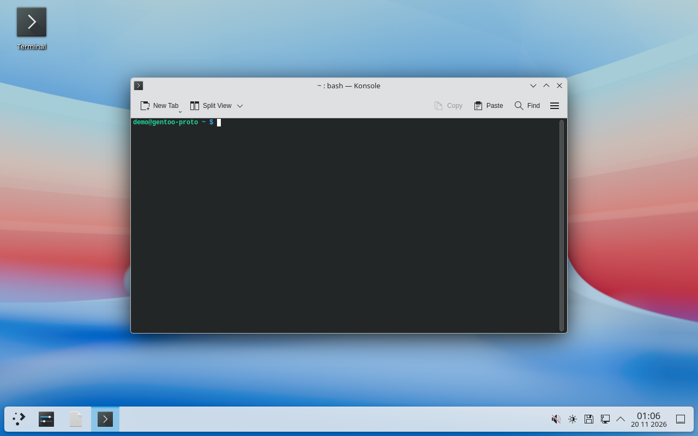
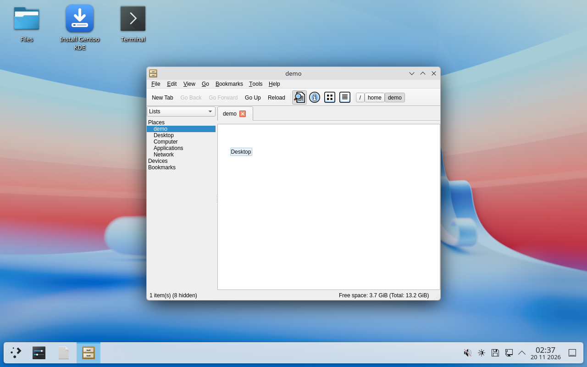
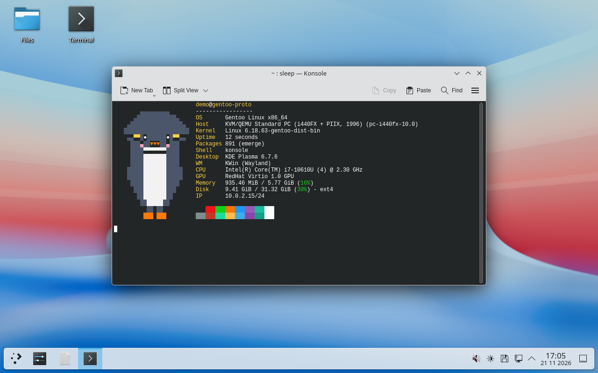

# Booting from a USB stick

The prototype now produces a **persistent** USB image, not a squashfs live CD:
it is the installed system from `work/gentoo.img`, copied onto a GPT disk with
both BIOS and UEFI bootloaders. Changes you make (files, settings, installed
packages) survive a reboot because they are written to the stick.

| Property | Value |
|---|---|
| Image | `dist/gentoo-kde-usb.img` |
| Allocated | ~9.6 GiB (raw image is 14 GiB) |
| Checksums | `dist/SHA256SUMS` |
| Size | 14 GiB (fits any "16 GB" stick, ~14.9 GiB usable) |
| Firmware | BIOS **and** UEFI |
| Partition table | GPT |
| Desktop | KDE Plasma 6.7.6, Wayland, autologin as `demo` |
| Installer | GTK 4 “Install Gentoo KDE” wizard on the desktop and in the menu |
| Terminal | Konsole on the desktop and in the menu; text login on `Ctrl+Alt+F3` |
| Files | PCManFM-Qt on the desktop and in the menu |

## Write it

You need a USB stick of at least 16 GB. Everything on it will be erased.

```sh
cd dist && sha256sum -c SHA256SUMS
cd .. && sudo bin/write-usb.sh /dev/sdX dist/gentoo-kde-usb.img
```

Replace `/dev/sdX` with the whole-disk device of the stick (check with
`lsblk`). The script refuses to touch a non-removable disk or the disk holding
your running root, and asks you to type the device name before writing.

Any image writer works too (balenaEtcher, `dd`, GNOME Disks). For `dd`:

```sh
sudo dd if=dist/gentoo-kde-usb.img of=/dev/sdX bs=4M conv=fsync status=progress
```

## Boot it

1. Enter the firmware boot menu (usually F12, F11, F9 or Esc during POST).
2. Pick the USB stick. It appears twice on most machines: one entry boots via
   UEFI, one via legacy/BIOS. **Both work.**
3. If the machine has Secure Boot enabled, turn it off first. The prototype
   bootloader is unsigned.
4. The image starts GRUB, then systemd, then SDDM, and logs `demo` in
   automatically. First boot to Plasma takes roughly 1-3 minutes depending on
   the machine.

Credentials:

| Account | Password | Notes |
|---|---|---|
| `demo` | `demo` | autologin on the graphical console; no `sudo`, use `su -` |
| `root` | `gentoo` | text console, or `su -` from the Terminal |

## What is on the stick

```
GPT
├─ p1  1 MiB    BIOS boot partition (GRUB core.img)
├─ p2  512 MiB  EFI System Partition (FAT32)
│               EFI/BOOT/BOOTX64.EFI + grub.cfg
└─ p3  ~13.5 GiB ext4 root, LABEL=gentoo-root
                /boot/grub/grub.cfg, kernel, generic initramfs
```

- GRUB is installed twice: `i386-pc` into the BIOS boot partition, and
  `x86_64-efi` at the removable-media fallback path `EFI/BOOT/BOOTX64.EFI`.
  The fallback path is what firmware uses when there is no NVRAM entry, which
  is the normal case for a USB stick.
- The EFI `grub.cfg` finds the root filesystem **by UUID** and loads
  `/boot/grub/grub.cfg` from it, so disk order and USB port do not matter.
- The initramfs is rebuilt with `dracut --no-hostonly`. The install-time one
  only contained virtio drivers and would fail to find the root filesystem on
  real SATA/NVMe/USB hardware.
- `/etc/fstab` uses UUIDs for both root and ESP.

## Terminal and recovery consoles

The image has no `sudo`, and the polkit rule only allows the desktop user to
run the installer. For a root shell, open **Terminal** (desktop icon or
application menu) and run:

```sh
su -
# password: gentoo
```

If the desktop is unusable, `Ctrl+Alt+F3` switches to a plain text login on
tty3 (log in as `root` with `gentoo`), and `Ctrl+Alt+F1` returns to Plasma.
A serial console on ttyS0 is enabled as well.



The desktop also has a **Files** icon (PCManFM-Qt), with the same entry in the
application menu. It stays available after installing and after removing KDE.



For a quick system summary, open **Terminal** and run `auk` (or `fastfetch`).
It prints the Auk Snares penguin logo with OS, kernel, CPU, memory, disk and
network details. The logo is a plain-text file at `/usr/share/auk/auk.txt` and
the config is `/etc/fastfetch/config.jsonc`, so both are easy to edit.



## Network and Wi-Fi

NetworkManager and `wpa_supplicant` are installed and enabled at boot. Wireless
firmware for Intel, Atheros, Broadcom, Marvell, MediaTek and Realtek cards is
included, so most laptop and Chromebook Wi-Fi chips should come up.

The firmware comes from Debian's `non-free-firmware` archive, because Gentoo's
binhost has no `sys-kernel/linux-firmware` build. `installer/install-wifi-firmware.py`
downloads the packages, verifies their SHA-256 hashes, and extracts only
`/usr/lib/firmware` plus the packages' copyright files. Run it with the image
(or any other root) mounted if you rebuild by hand:

```sh
sudo python3 installer/install-wifi-firmware.py /mnt/gentoo
```

Open **Terminal** and run:

```sh
nmtui
```

Choose **Activate a connection**, pick your network and enter the password. If
NetworkManager asks for authentication, enter the root password `gentoo`; or
start `nmtui` from a root shell (`su -`). The equivalent one-liner is:

```sh
nmcli device wifi list
nmcli device wifi connect "SSID" password "PASSWORD"
```

A few Chromebooks need board-specific NVRAM files (`brcmfmac*-pcie.txt`) that
are not part of the firmware packages. If no Wi-Fi device appears, check
`rfkill list` and `dmesg | grep -i firmware`. Wired Ethernet and USB tethering
work without any of this.

## Removing an existing swap partition

The installer repartitions the whole target disk, but it refuses a disk whose
swap is **still active** in the running kernel. A leftover swap signature is
fine: `lsblk` keeps showing `swap` after `swapoff`, but only `/proc/swaps`
matters.

Find the swap partition and turn it off:

```sh
lsblk -o NAME,SIZE,TYPE,FSTYPE,MOUNTPOINTS
swapoff -a
```

That is enough for the installer to accept the disk. To delete the partition
too:

```sh
fdisk /dev/nvme0n1     # p to print, d to delete, type the swap number, w to write
partprobe /dev/nvme0n1
```

Then remove the swap line from that system's `/etc/fstab` and any `resume=`
kernel argument used for hibernation; otherwise the existing install drops to
emergency mode on its next boot. If the swap lives in LVM or LUKS, use
`lvremove`/`cryptsetup` instead of `fdisk`.

## Install it onto a computer

On the live desktop, double-click **Install Gentoo KDE** (also under System in
the application menu). The wizard asks for a target disk, a computer name and a
user account, then copies this system onto the disk. It runs offline and
compiles nothing.

- The USB stick you booted from is never offered as a target.
- Disks with mounted partitions are excluded, including a Windows install.
- 16 GB minimum; the whole disk is erased.
- The result boots on **BIOS and UEFI** and keeps the account you chose
  (autologin enabled).

Full flow, backend behavior and limitations: [INSTALLER.md](INSTALLER.md).

## Limits (prototype, not a product)

- **Installer is offline whole-disk clone only.** It does not shrink Windows,
  dual-boot, or encrypt the disk.
- **No disk encryption, no secure boot signing, no rollback.**
- **Wireless firmware covers common cards** (Intel, Atheros, Broadcom, Marvell,
  MediaTek, Realtek). A few Chromebooks need board-specific Broadcom NVRAM
  files, which are not shipped; Ethernet and USB tethering always work.
- **x86-64 only, 64-bit userland only** (no 32-bit compatibility).
- The demo credentials are public and the root password is weak. Do not put
  personal data on it or expose it to an untrusted network.

## Rebuild from scratch

```sh
python3 bin/build_usb.py --force        # makes dist/gentoo-kde-usb.img (14 GiB)
python3 bin/verify_image.py             # BIOS boot test + screenshot
python3 bin/verify_image.py --uefi      # UEFI boot test + screenshot
xz -T0 -3 -k dist/gentoo-kde-usb.img    # optional: smaller upload, not the release
```

`build_usb.py` boots the live ISO, creates the GPT layout on a fresh sparse
image, copies the installed root filesystem, regenerates the initramfs, and
installs both bootloaders. The source disk is mounted read-write only long
enough for ext4 journal recovery, then remounted read-only for the copy.
